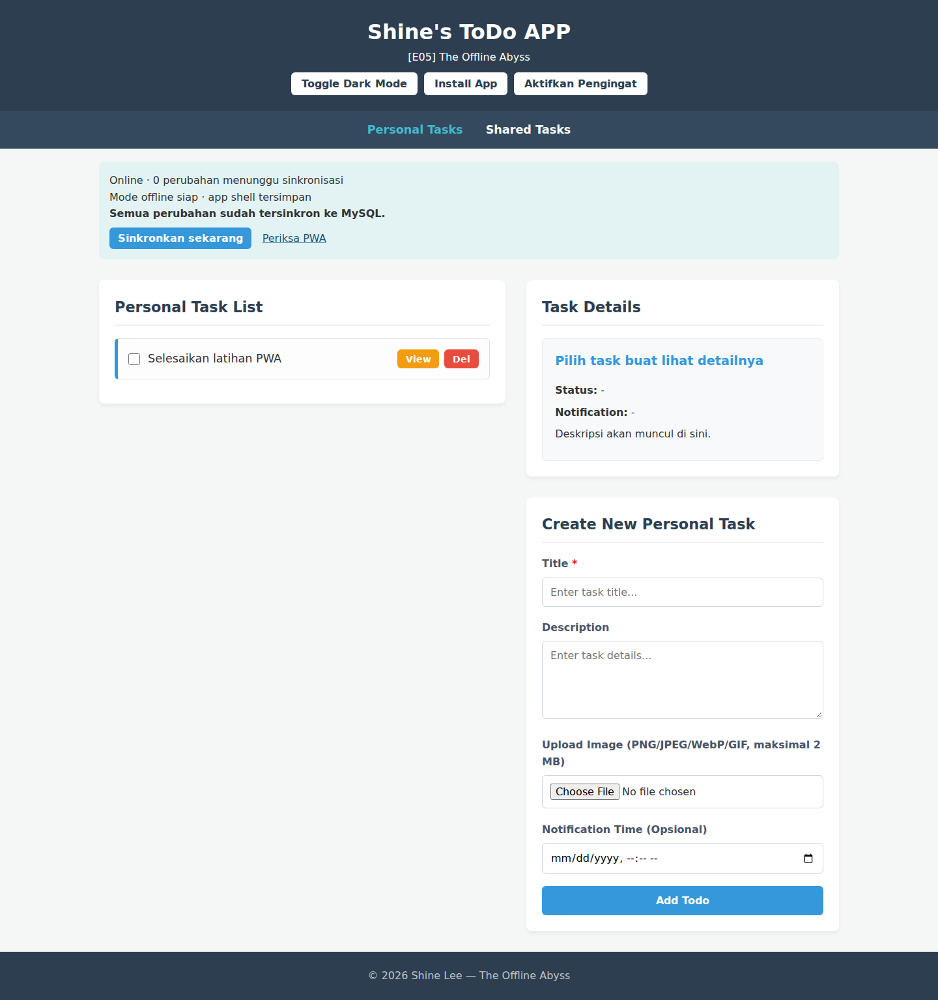
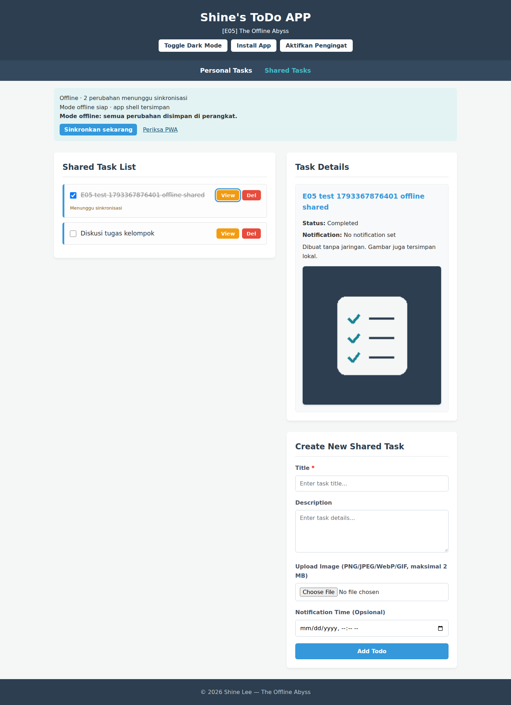
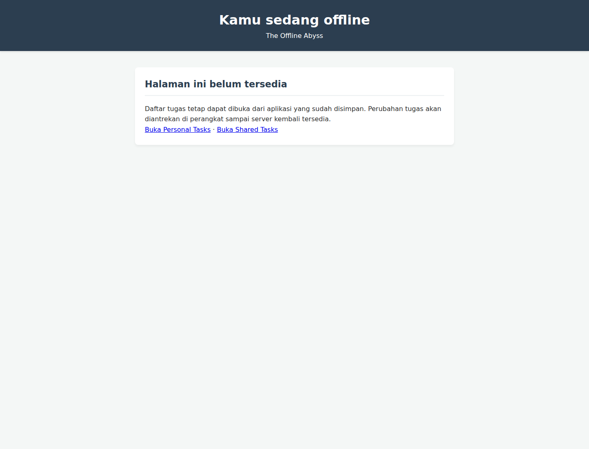
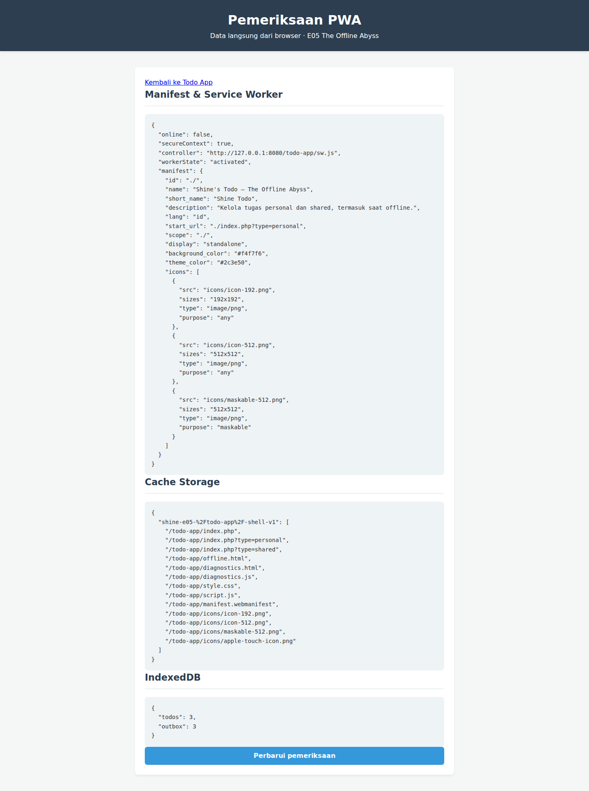
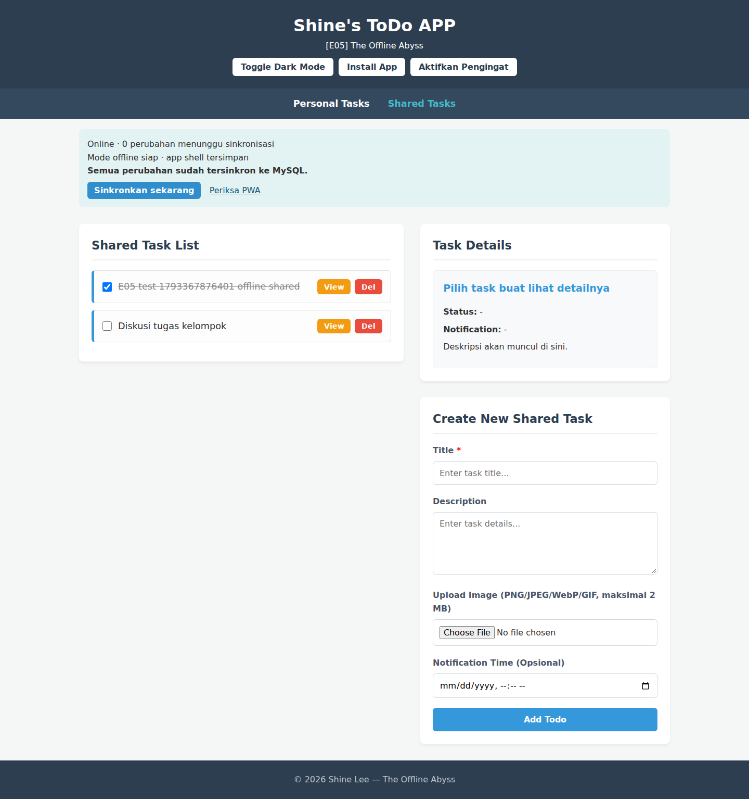
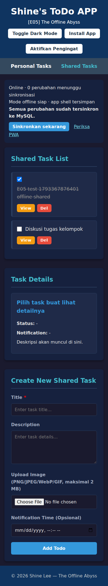

# Todo App - [E05] The Offline Abyss

## Identitas

- **Nama:** Shine Lee Romenzio Tarigan
- **NRP:** 5025251058
- **Kelas:** IF - Pemrograman Web - A

## Deskripsi

Proyek ini merupakan kelanjutan dari **[E04] The Iron Citadel**. Pada tugas **[E05] The Offline Abyss**, Todo App ditingkatkan menjadi **Progressive Web App (PWA)** yang dapat dipasang seperti aplikasi dan tetap digunakan tanpa koneksi jaringan setelah kunjungan online pertama.

Backend PHP, database MySQL, menu **Personal / Shared**, upload gambar, pengingat, serta dark mode dari E04 tetap dipertahankan. IndexedDB ditambahkan sebagai penyimpanan lokal dan antrean perubahan, sedangkan MySQL menjadi penyimpanan server ketika sinkronisasi berhasil.

Beberapa pembaruan utama yang diterapkan pada versi ini:

1. **Web App Manifest:** `manifest.webmanifest` mengatur nama aplikasi, `start_url`, `scope`, mode `standalone`, warna, dan ikon PNG lokal berukuran 192×192 serta 512×512. Ikon maskable dan Apple touch icon juga tersedia.
2. **Service Worker:** `sw.js` melakukan precache app shell, kedua halaman kategori, stylesheet, JavaScript, manifest, ikon, halaman pemeriksaan, serta `offline.html`.
3. **Offline CRUD:** Pengguna dapat menambah tugas beserta gambar, menandai selesai, melihat detail, dan menghapus tugas tanpa jaringan. Data bertahan setelah reload melalui IndexedDB.
4. **Sinkronisasi:** Perubahan lokal masuk ke outbox dan dikirim berurutan ketika jaringan dan server tersedia kembali. Tombol **Sinkronkan sekarang** dapat memicu percobaan ulang.
5. **Install App:** Tombol menyimpan event `beforeinstallprompt` dan memunculkan prompt browser melalui klik pengguna. Jika event belum tersedia, tombol menampilkan petunjuk instalasi manual.
6. **Status dan bukti:** Indikator menampilkan keadaan jaringan, kesiapan offline, dan jumlah perubahan tertunda. Bukti pengujian disertakan di bagian bawah README.

## Pemenuhan Tugas E05

| Persyaratan | Implementasi |
| --- | --- |
| Manifest, icons, dan link | `manifest.webmanifest`, `icons/`, `<link rel="manifest">` pada `index.php` |
| Precache shell dan offline page | Event `install` di `sw.js` dan `offline.html` |
| Strategi cache tiap resource | Tabel strategi cache di bawah |
| Tombol install | `#install-btn` dan event `beforeinstallprompt` di `script.js` |
| Pengujian jaringan mati dan bukti README | Screenshot offline, data DevTools Protocol, dan hasil tes di `docs/proof/` |

## Strategi Cache

| Resource | Strategi | Alasan |
| --- | --- | --- |
| Navigasi app `index.php` dan kategori | **Network first**, timeout 4 detik, fallback ke shell precache | Mengambil halaman terbaru saat tersedia, tetap terbuka saat offline |
| CSS, JS, manifest, dan ikon | **Cache first**, precache versi | Resource inti tersedia tanpa CDN atau jaringan |
| Gambar server di `uploads/` | **Cache first**, runtime cache | Upload menggunakan nama acak yang tidak berubah isinya |
| Data tugas dari `crud.php` | **Network only** untuk API; snapshot di **IndexedDB** | Respons CRUD tidak boleh dianggap sukses dari cache HTTP |
| Perubahan tugas offline | IndexedDB **outbox** | Perubahan dapat disimpan tanpa bergantung pada server |
| Navigasi lain yang belum tersimpan | Network, lalu **offline.html** ketika gagal | Menampilkan halaman fallback yang jelas |

Nama cache menggunakan prefix berdasarkan folder aplikasi agar cache proyek lain pada origin yang sama tidak ikut dihapus. Naikkan versi cache di `sw.js` setiap mengubah shell/CSS/JS/icon. Aktivasi worker membersihkan versi lama milik aplikasi ini.

## Cara Menjalankan dengan XAMPP

Aplikasi memerlukan **PHP 8.1+**, ekstensi **mysqli** dan **fileinfo**, serta **MySQL/MariaDB**. Tidak ada build frontend dan tidak perlu Node.js untuk memakai aplikasinya.

1. Ekstrak proyek, lalu letakkan folder aplikasi di `C:\xampp\htdocs\todo-app-e05`.
2. Buka XAMPP Control Panel dan klik **Start** pada **Apache** serta **MySQL**.
3. Buka `http://localhost/phpmyadmin`.
4. Pilih **salah satu** cara database berikut:
   - **Database baru:** import `data.sql`. File ini membuat `todo_db`, tabel `todos`, tabel `applied_operations`, serta dua contoh tugas. Gunakan database kosong; bila nama database diganti, sesuaikan SQL dan `config.php`.
   - **Melanjutkan database E04:** backup database terlebih dahulu, lalu jalankan `migrate-e04.sql` **satu kali** pada database E04. Data lama tetap dipertahankan dan diberi `client_id`. Jangan memakai `data.sql` sebagai pengganti migrasi tabel E04 yang sudah ada.
5. Periksa `config.php`: default host `127.0.0.1`, user `root`, password kosong, database `todo_db`, port `3306`. Sesuaikan dengan XAMPP milikmu. Environment variable `DB_HOST`, `DB_USER`, `DB_PASS`, `DB_NAME`, dan `DB_PORT` juga didukung.
6. Pastikan PHP dapat menulis folder `uploads/`. Untuk upload gambar 2 MB, atur `upload_max_filesize` minimal `2M` dan `post_max_size` minimal `8M` di `php.ini`, lalu restart Apache jika diubah.
7. Buka **`http://localhost/todo-app-e05/index.php`** menggunakan Chrome atau Edge.
8. Tunggu hingga muncul **“Mode offline siap · app shell tersimpan”** dan **“Semua perubahan sudah tersinkron ke MySQL.”** sebelum mematikan jaringan.
9. Klik **Install App** untuk memasang aplikasi. Jika prompt belum muncul, ikuti petunjuk atau gunakan menu instalasi browser.

> Buka melalui web server; `file://` tidak menjalankan PHP atau service worker. Di luar localhost, gunakan HTTPS. GitHub menyimpan source dan README proyek ini; GitHub Pages tidak menjalankan backend PHP/MySQL.

Alternatif bagi pengguna yang sudah mempunyai PHP dan database:

```bash
php -S localhost:8080
```

Jalankan dari folder proyek, lalu buka `http://localhost:8080/index.php`. Database tetap harus berjalan dan sudah disiapkan.

## Alur Data Offline

1. Aplikasi membaca snapshot tugas dari IndexedDB agar daftar lokal langsung tersedia.
2. Tambah, centang selesai, dan hapus disimpan bersama operasi outbox dalam satu transaksi IndexedDB.
3. Jika online, operasi dikirim ke `crud.php?action=sync` secara berurutan.
4. Server mencatat `op_id` unik dalam transaksi yang sama dengan perubahan tugas. Pengiriman ulang operasi yang sama tidak menggandakan tugas.
5. Operasi hanya dihapus dari outbox setelah server memberi respons sukses. Jika permintaan gagal atau timeout, operasi tetap dapat dikirim ulang.
6. Setelah antrean terkirim, snapshot kedua kategori diambil dari MySQL. Gambar juga disimpan sebagai Blob di IndexedDB untuk detail offline.

`navigator.onLine` menunjukkan koneksi perangkat, bukan jaminan database tersedia. Jika Apache/MySQL tidak dapat diakses, aplikasi menampilkan pesan dan mempertahankan data lokal. Sinkronisasi dicoba ketika halaman dibuka, koneksi kembali, tombol ditekan, dan setiap 30 detik selama aplikasi terbuka. Web Locks menserialisasi penulisan dan sinkronisasi antar-tab pada browser pendukung.

## Cara Menguji Offline melalui DevTools

1. Buka aplikasi dalam kondisi online dan tunggu status offline siap serta sinkron selesai.
2. Buka **F12 → Application → Manifest**. Periksa nama, ikon, `start_url`, `scope`, dan `display: standalone`.
3. Buka **Application → Service Workers**. Pastikan `sw.js` aktif dan halaman dikontrol worker.
4. Buka **Application → Cache Storage** dan refresh daftar. Cache shell harus berisi `index.php`, kedua parameter kategori, `offline.html`, CSS, JS, manifest, dan ikon.
5. Pada **Network**, ubah throttling menjadi **Offline**. Jangan aktifkan **Bypass for network** pada service worker.
6. Reload halaman. Tambahkan tugas dengan gambar, centang selesai, lalu pindah Personal/Shared. Daftar tetap berfungsi dan perubahan masuk antrean.
7. Reload lagi untuk memastikan data tetap ada. Hapus salah satu tugas untuk menguji delete offline.
8. Buka `http://localhost/todo-app-e05/belum-tersimpan.html` saat offline untuk melihat fallback `offline.html`.
9. Kembalikan Network ke **No throttling**, buka aplikasi, dan klik **Sinkronkan sekarang**. Antrean harus kembali menjadi **0 perubahan**. Periksa database atau browser lain untuk memastikan perubahan masuk ke server.

## Bukti Pengujian

Bukti di bawah dihasilkan dari eksekusi browser otomatis terhadap backend PHP dan database MariaDB sungguhan, tanpa mock endpoint. `test-report.json` mencatat lingkungan, waktu, dan setiap pemeriksaan. File `devtools-protocol.json` berisi hasil **Chrome DevTools Protocol** untuk manifest, installability, dan isi cache; screenshot halaman **Periksa PWA** menampilkan data browser langsung, bukan tampilan panel DevTools.

### Tampilan Online



### Tambah Tugas, Gambar, dan Status Selesai saat Offline



### Halaman Fallback Offline



### Manifest, Cache Storage, dan IndexedDB saat Offline



- [Hasil Manifest dan Cache Storage melalui DevTools Protocol](docs/proof/devtools-protocol.json)
- [Laporan pengujian otomatis — 15 pemeriksaan lolos](docs/proof/test-report.json)
- [Pemeriksaan migrasi E04, kegagalan database, dan sintaks — 3 pemeriksaan lolos](docs/proof/backend-checks.json)

### Sinkronisasi Kembali ke Server



### Tampilan Mobile dan Dark Mode



## Menjalankan Ulang Tes Otomatis

Gunakan database pengujian terpisah. Tes membuat tugas pengujian, memeriksa hasil server, lalu membersihkannya. Screenshot dan laporan akan dibuat ulang.

```bash
npm install
npx playwright install chromium
```

Dengan aplikasi berjalan pada `http://127.0.0.1:8080/todo-app/`, jalankan:

```bash
npm test
```

Jika menggunakan folder XAMPP dari contoh di atas, pada PowerShell:

```powershell
$env:BASE_URL="http://localhost/todo-app-e05/"
npm test
```

Pada Linux/macOS:

```bash
BASE_URL=http://localhost/todo-app-e05/ npm test
```

## Struktur Proyek

```text
5025251058_Todo-App-E05/
├── index.php                 # Shell PHP tanpa ketergantungan database
├── menu-bar.php              # Navigasi Personal dan Shared
├── content.php               # Daftar, detail, dan form tugas
├── config.php                # Konfigurasi koneksi MySQL
├── crud.php                  # Snapshot dan operasi sync idempotent
├── data.sql                  # Setup database baru
├── migrate-e04.sql           # Migrasi satu kali untuk database E04
├── script.js                 # IndexedDB, outbox, CRUD, install, pengingat
├── style.css                 # Tampilan responsif dan dark mode
├── manifest.webmanifest      # Identitas PWA
├── sw.js                     # Precache, fetch, lifecycle, notifikasi
├── offline.html              # Fallback navigasi offline
├── diagnostics.html          # Pemeriksaan PWA di browser
├── diagnostics.js
├── icons/                    # Seluruh ikon lokal
├── uploads/                  # Gambar tersimpan di server
├── docs/proof/               # Screenshot dan laporan pengujian
├── package.json              # Dependensi opsional untuk tes
└── tests/e05.cjs              # Pengujian end-to-end
```

## Catatan Penggunaan

- Kunjungan online pertama diperlukan untuk menyimpan shell dan mengambil tugas server. Membersihkan site data/browser storage akan menghapus tugas lokal yang belum tersinkron.
- Sinkronisasi berjalan ketika aplikasi terbuka; implementasi ini tidak memerlukan Background Sync atau Workbox. Instalasi OS melalui dialog Chrome/Edge tetap perlu dikonfirmasi manual oleh pengguna.
- Pengingat diperiksa setiap 30 detik saat halaman kategori terkait terbuka dan izin notifikasi diberikan. Ini bukan push notification atau alarm terjadwal ketika aplikasi ditutup.
- Pada perubahan bersamaan dari beberapa perangkat, operasi yang terakhir diterima server menentukan isi tugas. Tidak ada penggabungan konflik otomatis.
- Seperti E04, contoh tugas ini belum memiliki login atau pembatasan pengguna. Personal/Shared merupakan kategori; gunakan sebagai proyek praktikum lokal. Jika Web Locks tidak tersedia, gunakan satu tab untuk mengubah tugas.

## Referensi

- [MDN — Using Service Workers](https://developer.mozilla.org/en-US/docs/Web/API/Service_Worker_API/Using_Service_Workers)
- [MDN — Caching](https://developer.mozilla.org/en-US/docs/Web/Progressive_web_apps/Guides/Caching)
- [MDN — Making PWAs installable](https://developer.mozilla.org/en-US/docs/Web/Progressive_web_apps/Guides/Making_PWAs_installable)
